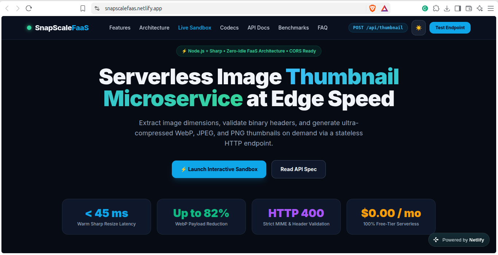
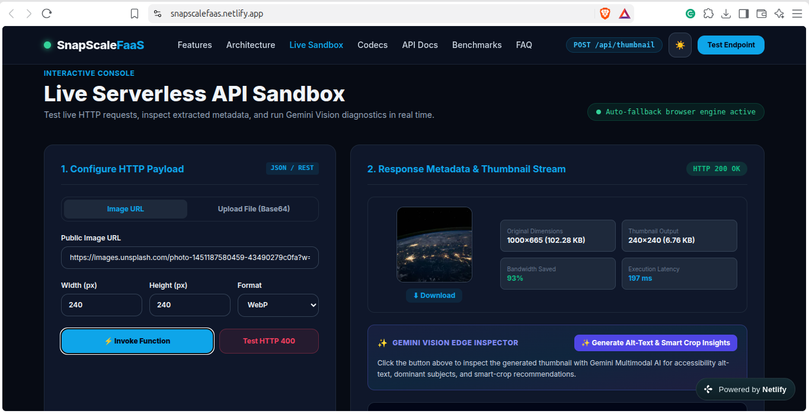
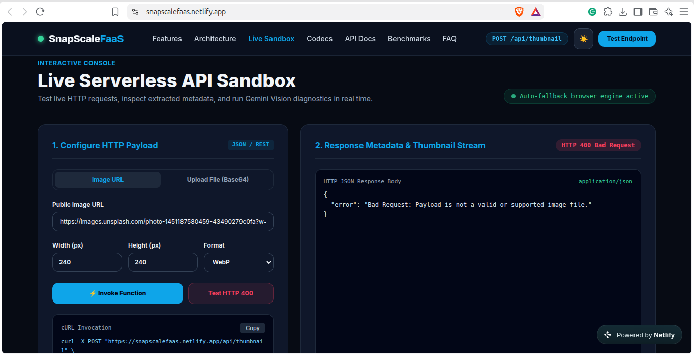
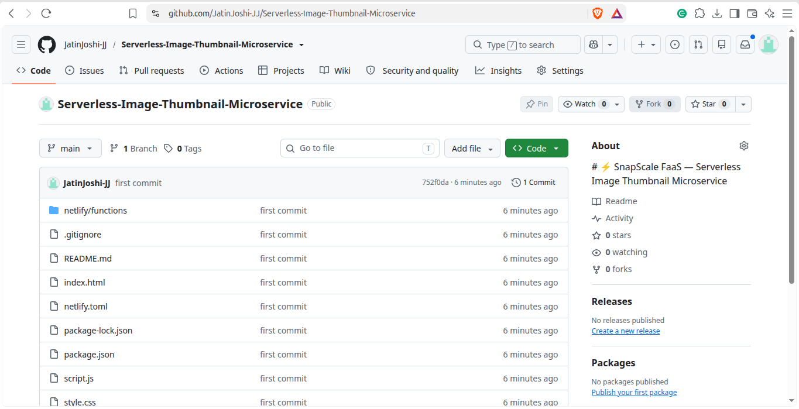

# ⚡ SnapScale FaaS — Serverless Image Thumbnail Microservice

[](https://snapscalefaas.netlify.app/)
[](https://sharp.pixelplumbing.com/)
[-38BDF8?style=for-the-badge)](https://developer.mozilla.org/en-US/docs/Web/HTTP/CORS)
[](https://opensource.org/licenses/MIT)

A stateless, zero-idle **Serverless Image Thumbnail Microservice** powered by **Node.js**, **Sharp (`libvips`)**, and **Netlify Functions**, paired with an interactive browser-based API Sandbox and **Gemini Multimodal AI** inspection tools.

---

## 🌐 Live Demo & Endpoint

- **🚀 Live Web Application & Sandbox:** [https://snapscalefaas.netlify.app/](https://snapscalefaas.netlify.app/)
- **🔌 Public REST API Endpoint:** `https://snapscalefaas.netlify.app/api/thumbnail`
- **📦 Source Repository:** [https://github.com/JatinJoshi-JJ/Serverless-Image-Thumbnail-Microservice](https://github.com/JatinJoshi-JJ/Serverless-Image-Thumbnail-Microservice)

---

## ✨ Key Features

- **🔗 Dual Ingestion Modes:** Accepts both public HTTP/HTTPS `imageUrl` links and raw/Data-URI `imageBase64` payloads in a unified JSON request.
- **📐 Automated Metadata Extraction:** Inspects binary image headers via `sharp().metadata()` before transcoding to report exact original dimensions (`width × height`), format, and byte size.
- **🖼️ Adaptive Thumbnail Generation:** Resizes and center-crops images into **WebP**, **JPEG**, or **PNG** (clamped safely between `16px` and `1024px`) and returns an optimized Data URI + compression metrics.
- **🛡️ Strict `HTTP 400` Payload Guardrails:** Validates remote `Content-Type` headers and image magic bytes—immediately rejecting non-image payloads, malformed JSON, or invalid codecs with `400 Bad Request`.
- **🌐 Cross-Origin Resource Sharing (CORS):** Pre-configured with `Access-Control-Allow-Origin: *` and `OPTIONS` preflight handling so any frontend application can invoke the microservice directly.
- **❄️ Cold-Start Optimized:** Bundled via `esbuild` with external native `libvips` binaries (`external_node_modules = ["sharp"]`) for sub-50ms warm execution and fast cold starts.
- **🤖 Gemini Multimodal AI Integration (Sandbox):**
  - **Gemini Vision Edge Inspector:** Generates SEO-friendly HTML `alt` text, focal-point crop hints, and CDN optimization tips from output thumbnails.
  - **Synthetic Test Image Generator:** Generates sample images on the fly directly into the Base64 payload tester.

---

## 🏗️ 4-Stage Serverless Execution Pipeline

```text
┌───────────────────┐     ┌────────────────────┐     ┌────────────────────┐     ┌─────────────────────┐
│ 1. Edge Gateway   │ ──▶ │ 2. MIME & Buffer   │ ──▶ │ 3. Sharp/libvips   │ ──▶ │ 4. JSON & Data URI  │
│  & CORS Preflight │     │   Validation Gate  │     │  Metadata & Resize │     │  Telemetry Response │
└───────────────────┘     └────────────────────┘     └────────────────────┘     └─────────────────────┘
```

1. **Edge Gateway & CORS:** Netlify Edge redirects `/api/thumbnail` to `/.netlify/functions/thumbnail` and resolves `OPTIONS` preflight requests with `204 No Content`.
2. **Buffer & MIME Gate:** Streams remote image bytes or decodes Base64 strings into a Node.js `Buffer`, rejecting non-image payloads with `HTTP 400`.
3. **Sharp / `libvips` Processing:** Extracts source dimensions and performs center-cropped resampling into WebP, JPEG, or PNG at `80%` quality in RAM (zero disk I/O).
4. **Structured Response:** Returns original vs. thumbnail telemetry, bandwidth savings percentage, processing latency (`ms`), and a ready-to-render Data URI.

---

## 🛠️ Tech Stack

| Layer | Technology |
| :--- | :--- |
| **Serverless Compute** | Netlify Functions (AWS Lambda under the hood), Node.js |
| **Image Engine** | Sharp (`libvips` C++ bindings) |
| **Bundler & Routing** | `esbuild` + `netlify.toml` redirect rules |
| **Frontend Sandbox** | HTML5, Tailwind CSS, Vanilla JavaScript, Lenis Smooth Scroll |
| **AI Diagnostics** | Google Gemini API (`gemini-3-flash-preview` & `gemini-3.1-flash-lite-image`) |

---

## 📂 Project Structure

```text
Serverless-Image-Thumbnail-Microservice/
├── netlify/
│   └── functions/
│       └── thumbnail.js            # Core serverless FaaS handler (Sharp + validation + CORS)
├── screenshots/
│   ├── snapscale-landing.png       # Live web app hero & telemetry preview
│   ├── api-sandbox-200.png         # Successful thumbnail generation & metadata output
│   ├── validation-400.png          # HTTP 400 Bad Request validation proof
│   └── github-repo-structure.png   # Public GitHub repository structure & deliverables
├── index.html                      # Multi-section UI & Interactive API Sandbox
├── netlify.toml                    # Netlify build, esbuild bundler & /api/thumbnail routing
├── package.json                    # Project dependencies (sharp)
├── package-lock.json               # Deterministic dependency lockfile
├── .gitignore                      # Excludes node_modules and local cache
└── README.md                       # Documentation & API invocation examples
```

---

## 📖 REST API Documentation

### Endpoint
`POST /api/thumbnail` *(also supports `GET /api/thumbnail?url=<IMAGE_URL>&width=240&height=240&format=webp`)*

### Request Parameters

| Parameter | Type | Required | Default | Description |
| :--- | :--- | :--- | :--- | :--- |
| `imageUrl` | `string` | Conditional* | — | Public HTTP/HTTPS image URL (*required if `imageBase64` is omitted*). |
| `imageBase64` | `string` | Conditional* | — | Raw Base64 string or `data:image/...;base64,...` URI. |
| `width` | `integer` | No | `200` | Target thumbnail width in pixels (`16` – `1024`). |
| `height` | `integer` | No | `200` | Target thumbnail height in pixels (`16` – `1024`). |
| `format` | `string` | No | `"webp"` | Output format: `"webp"`, `"jpeg"`, or `"png"`. |

### HTTP Status Codes

- **`200 OK`:** Image validated, metadata extracted, and thumbnail generated.
- **`204 No Content`:** Successful CORS `OPTIONS` preflight response.
- **`400 Bad Request`:** Missing image input, invalid URL protocol, unsupported format, or non-image payload.
- **`405 Method Not Allowed`:** HTTP methods other than `GET`, `POST`, or `OPTIONS`.
- **`500 Internal Server Error`:** Unexpected runtime failure during buffer processing.

---

## 💻 cURL & Postman Invocation Examples

### 1️⃣ Generate Thumbnail from Public Image URL (`cURL`)
```bash
curl -X POST "https://snapscalefaas.netlify.app/api/thumbnail" \
  -H "Content-Type: application/json" \
  -d '{
    "imageUrl": "https://images.unsplash.com/photo-1451187580459-43490279c0fa?w=1000",
    "width": 240,
    "height": 240,
    "format": "webp"
  }'
```

### 2️⃣ Generate Thumbnail from Base64 Payload (`cURL`)
```bash
curl -X POST "https://snapscalefaas.netlify.app/api/thumbnail" \
  -H "Content-Type: application/json" \
  -d '{
    "imageBase64": "data:image/png;base64,iVBORw0KGgoAAAANSUhEUgAAAAEAAAABCAYAAAAfFcSJAAAADUlEQVR42mNk+M9QDwADhgGAWjR9awAAAABJRU5ErkJggg==",
    "width": 128,
    "height": 128,
    "format": "png"
  }'
```

### 3️⃣ Test Non-Image Payload Validation (`HTTP 400 Bad Request`)
```bash
curl -i -X POST "https://snapscalefaas.netlify.app/api/thumbnail" \
  -H "Content-Type: application/json" \
  -d '{
    "imageBase64": "SGVsbG8gV29ybGQh",
    "width": 200,
    "height": 200
  }'
```

### 4️⃣ Sample `200 OK` JSON Response
```json
{
  "success": true,
  "processingTimeMs": 38,
  "original": {
    "format": "jpeg",
    "width": 1000,
    "height": 665,
    "sizeBytes": 1330000,
    "sizeKB": 1298.83
  },
  "thumbnail": {
    "format": "webp",
    "width": 240,
    "height": 240,
    "sizeBytes": 6998,
    "sizeKB": 6.83,
    "compressionRatio": "99%",
    "dataUri": "data:image/webp;base64,UklGR..."
  }
}
```

### 5️⃣ Postman Setup
1. Create a new **POST** request to `https://snapscalefaas.netlify.app/api/thumbnail`.
2. Under **Headers**, set `Content-Type: application/json`.
3. Under **Body → raw (JSON)**, paste the JSON payload above and click **Send**.

---

## ⚙️ Local Setup & Deployment

### Run Locally
```bash
# 1. Clone the repository
git clone https://github.com/JatinJoshi-JJ/Serverless-Image-Thumbnail-Microservice.git
cd Serverless-Image-Thumbnail-Microservice

# 2. Install dependencies
npm install

# 3. Start local Netlify serverless dev server (optional)
npx netlify-cli dev
```

### Deploy to Netlify
1. Push the repository (`netlify/functions/thumbnail.js`, `netlify.toml`, `package.json`, `index.html`) to GitHub.
2. Import the repository into **Netlify** (`Add new site → Import an existing project`).
3. Netlify automatically installs `sharp` for Linux x64, bundles `thumbnail.js` using `esbuild`, and activates the `/api/thumbnail` edge route.

---

## 📸 Verification Screenshots

### 1. Live Serverless Microservice Landing & Telemetry


### 2. Interactive API Sandbox (`200 OK` Thumbnail & Metadata)


### 3. Non-Image Payload Guardrail (`400 Bad Request`)


### 4. GitHub Repository Structure & Deliverables


---

## 📄 License

This project is open-source and available under the [MIT License](LICENSE).